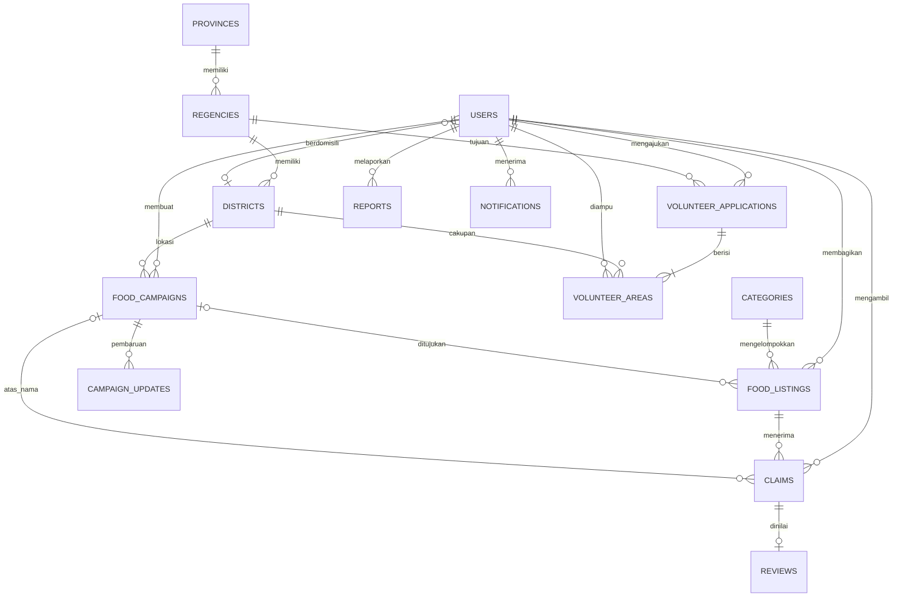

# SDD — Software Design Document

**Judul Project:** Website Pencegahan Food Waste dan Distribusi Makanan Berlebih Berbasis Web dan Geolokasi
**Nama Kode:** Locabite
**Framework:** Laravel 13
**Penyusun:** Rofiq Syaifurrohman (NIM 2024150032)
**Mata Kuliah:** Web Framework 2026
**Versi Dokumen:** 1.2 (hasil audit: perbaikan logika, privasi lokasi, siklus klaim, dan keamanan)

### Ringkasan Perubahan dari Versi 1.0
| Aspek | Versi 1.0 | Versi 1.1 |
|---|---|---|
| Peran donatur dan penerima | Dua peran terpisah | **Satu pengguna** yang bisa membagikan sekaligus mengambil makanan |
| Relawan | Peran tetap | **Peran tambahan** yang diajukan per kecamatan dalam satu kabupaten/kota |
| Admin | Pengelola sistem | Tetap |
| Fitur baru | - | **Galang makanan** (artikel kebutuhan panti, ponpes, tunawisma) oleh relawan |
| Data wilayah | Tidak ada | Provinsi, kabupaten/kota, kecamatan |

### Catatan Revisi 1.2 (Hasil Audit)
Audit dilakukan terhadap versi 1.1 dengan pemeriksaan logika dan pengujian numerik kecil (rumus jarak, bounding box, trilaterasi). Temuan utama dan perbaikannya:

| # | Temuan | Dampak | Perbaikan di versi 1.2 |
|---|---|---|---|
| 1 | Rumus Haversine memanggil `acos` tanpa pembatasan. Pada simulasi, pembulatan floating point membuat argumen > 1 pada sekitar 6% titik yang identik | Listing tepat di titik pengguna bisa **hilang** dari hasil (NULL) | `LEAST(1, GREATEST(-1, ...))` (bagian 6.2) |
| 2 | Jarak presisi + koordinat tepat memungkinkan **trilaterasi**: tiga kueri sudah cukup menebak lokasi pemberi (galat simulasi mendekati 0 m) | Alamat rumah pemberi individu bocor | Koordinat publik (jitter tersimpan), jarak dibulatkan, alamat tepat hanya untuk pengambil yang disetujui (6.5) |
| 3 | Membatalkan klaim yang sudah disetujui tidak mengembalikan porsi | Porsi "hilang" selamanya, listing macet di "dipesan" | `cancelApproved` mengembalikan porsi dan menghitung ulang status (8.4) |
| 4 | Tidak ada nasib klaim saat listing kedaluwarsa (klaim menunggu atau disetujui tapi tidak datang) | Data tidak konsisten, tidak ada penanganan tidak datang | Status klaim `expired` dan `no_show`, pembatasan akun (3.7, 8.5) |
| 5 | Status `reserved` dan `completed` tidak punya aturan transisi | Status listing bisa salah | Status listing diturunkan oleh `syncListingStatus` (3.6, 8.4) |
| 6 | Query pencarian tidak memeriksa `available_from` | Listing terjadwal muncul sebelum waktunya | Ditambahkan pada scope `visibleToMap` (6.2) |
| 7 | Tidak ada batas porsi per klaim dan klaim ganda per listing | Penimbunan porsi oleh satu pengguna | `max_portions_per_claim`, kunci unik klaim aktif (3.7, 5.2) |
| 8 | `volunteer_areas` unique(user_id, district_id) + `firstOrCreate` | Pengajuan ulang setelah ditolak atau mundur **tidak berpengaruh** | Logika pengajuan ulang dengan cooldown (8.3) |
| 9 | Status ringkas `volunteer_applications` menduplikasi status per kecamatan | Dua sumber kebenaran, bisa tidak sinkron | Status pengajuan diturunkan; keputusan disimpan per kecamatan (5.2) |
| 10 | Klaim atas nama galang memeriksa kecamatan listing, bukan kecamatan galang | Relawan dapat mengklaim untuk galang di luar wilayahnya | Pemeriksaan kecamatan dan kabupaten/kota galang (8.4) |
| 11 | Relawan keluar atau dicabut, tetapi galangnya tetap terbit | Galang tanpa pengelola | Status `paused` otomatis (3.6, 8.3) |
| 12 | Prioritas 2 jam bisa melewati batas waktu listing | Prioritas habis setelah makanan kedaluwarsa | Prioritas dibatasi `min(+2 jam, kedaluwarsa - 60 menit)` (3.7) |
| 13 | Validasi "pin di luar kecamatan" mustahil tanpa batas poligon kecamatan | Aturan tidak bisa ditegakkan | Kecamatan dipilih manual + pemeriksaan jarak ke titik pusat sebagai peringatan, keputusan akhir di tinjauan admin (3.7, 6.4) |
| 14 | Zona waktu Indonesia (WIB, WITA, WIT) tidak ditangani | Batas waktu salah tampil di luar Jawa | Simpan UTC, tampil sesuai zona provinsi (6.6) |
| 15 | Foto unggahan dapat memuat metadata GPS (EXIF) | Lokasi tepat bocor lewat foto | Foto di-encode ulang tanpa EXIF (9) |
| 16 | Kode ambil 8 karakter tanpa batas percobaan | Dapat ditebak | Batas percobaan dan alfabet tanpa karakter ambigu (8.4) |
| 17 | Tidak ada atribut keamanan pangan (jenis makanan, waktu dibuat, alergen) | Risiko kesehatan, informasi kurang | Kolom `food_type`, `prepared_at`, `allergens`, pernyataan halal bersifat klaim pemberi (5.2) |
| 18 | Peran bisa dikirim lewat form registrasi (mass assignment) bila lalai | Eskalasi menjadi admin | `role` tidak pernah `fillable`, diuji (9, 10) |
| 19 | Klaim target performa 500 ms tanpa pengukuran | Janji tidak terbukti | Dijadikan target yang diuji dengan benchmark (4, 10) |

> Jujur tentang batasannya: dokumen ini belum dijalankan sebagai aplikasi. Semua perbaikan di atas adalah rancangan dan perlu diuji saat implementasi.

---

## 1. Pendahuluan

### 1.1 Latar Belakang
Makanan layak konsumsi masih banyak terbuang dari restoran, toko roti, hotel, katering, dan rumah tangga, sementara sebagian masyarakat masih kesulitan mendapatkan makanan. Kendala utamanya adalah tidak adanya penghubung yang cepat antara pihak yang memiliki makanan berlebih dan pihak yang membutuhkannya dalam batas waktu layak konsumsi yang singkat.

Locabite adalah aplikasi web yang menghubungkan pengguna berdasarkan **lokasi terdekat** (geolokasi) dan **batas waktu layak konsumsi**. Setiap pengguna dapat membagikan surplus makanannya dan juga mengambil surplus makanan pengguna lain. Pengguna yang ingin berperan lebih dapat mengajukan diri sebagai **relawan** di wilayah tertentu untuk membantu menyalurkan makanan ke panti, pondok pesantren, dan tunawisma lewat **galang makanan**.

### 1.2 Tujuan
1. Menyediakan platform untuk mempublikasikan surplus makanan beserta lokasi dan batas waktu ambil.
2. Memudahkan pengguna menemukan makanan terdekat melalui peta interaktif.
3. Mencatat dan memantau alur donasi dari tersedia sampai diambil.
4. Menyediakan jalur relawan berbasis wilayah agar penyaluran ke kelompok rentan lebih terorganisasi.
5. Menyajikan statistik dampak (jumlah porsi terselamatkan) agar program dapat dievaluasi.

### 1.3 Ruang Lingkup
**Termasuk (In Scope):**
- Registrasi, login, dan profil pengguna tunggal.
- Unggah surplus makanan dengan titik lokasi di peta.
- Pencarian makanan terdekat berdasarkan radius dan filter.
- Alur klaim, verifikasi pengambilan, dan riwayat (sebagai pemberi maupun pengambil).
- Pengajuan relawan per kecamatan dan persetujuan admin.
- Galang makanan: artikel kebutuhan penerima manfaat yang dibuat relawan.
- Notifikasi dalam aplikasi dan email.
- Dashboard statistik dan panel admin.

**Tidak Termasuk (Out of Scope):**
- Pembayaran atau jual beli makanan.
- Donasi uang pada galang makanan (galang hanya untuk makanan).
- Aplikasi mobile native.
- Pengiriman otomatis dengan kurir pihak ketiga.
- Sertifikasi halal atau jaminan kelayakan pangan oleh sistem. Informasi tersebut berupa **pernyataan pemberi**.

### 1.4 Definisi dan Istilah
| Istilah | Arti |
|---|---|
| Pengguna | Akun terdaftar yang dapat membagikan dan mengambil makanan |
| Pemberi | Pengguna yang mengunggah sebuah listing (peran per transaksi, bukan peran akun) |
| Pengambil | Pengguna yang mengklaim sebuah listing (peran per transaksi) |
| Relawan | Pengguna yang pengajuannya disetujui admin untuk satu atau lebih kecamatan |
| Wilayah | Hierarki provinsi, kabupaten/kota, dan kecamatan |
| Listing | Satu postingan surplus makanan |
| Klaim | Permintaan pengguna untuk mengambil sebuah listing |
| Galang makanan | Artikel kebutuhan makanan sebuah panti, pondok pesantren, atau tunawisma yang dibuat relawan |
| Penerima manfaat | Pihak tujuan galang makanan (panti asuhan, ponpes, panti jompo, tunawisma, dll.) |
| Haversine | Rumus untuk menghitung jarak dua titik koordinat di permukaan bumi |

---

## 2. Gambaran Umum Sistem

### 2.1 Aktor dan Peran
Sistem hanya memiliki dua peran akun. Kemampuan relawan diturunkan dari data wilayah yang disetujui, bukan dari peran terpisah.

| Aktor | Deskripsi |
|---|---|
| Tamu | Pengunjung belum login: melihat peta publik, listing, dan artikel galang makanan |
| Pengguna | Dapat **membagikan** makanan dan **mengambil** makanan pengguna lain dengan satu akun |
| Relawan (peran tambahan) | Pengguna dengan minimal satu wilayah kecamatan berstatus disetujui. Mendapat fitur tambahan di wilayahnya |
| Admin | Mengelola pengguna, persetujuan relawan, moderasi galang makanan, laporan, dan data master |

```
Tamu --daftar--> Pengguna --ajukan relawan (kab/kota + kecamatan)--> [admin menyetujui] --> Relawan
```

**Kemampuan menurut peran:**
| Kemampuan | Tamu | Pengguna | Relawan | Admin |
|---|:-:|:-:|:-:|:-:|
| Melihat peta dan listing | Ya | Ya | Ya | Ya |
| Membagikan makanan | - | Ya | Ya | Ya |
| Mengambil makanan | - | Ya | Ya | Ya |
| Mengajukan diri sebagai relawan | - | Ya | Ya (tambah wilayah) | - |
| Membuat artikel galang makanan | - | - | Ya (di wilayahnya) | Ya |
| Mengklaim listing atas nama galang makanan | - | - | Ya (di wilayahnya) | - |
| Menyetujui relawan dan galang makanan | - | - | - | Ya |
| Mengelola pengguna dan laporan | - | - | - | Ya |

### 2.2 Arsitektur
Arsitektur menggunakan pola **MVC monolit** Laravel dengan pemisahan logika bisnis ke dalam *Service/Action class*.

```
[Browser]
   |  HTTPS (Geolocation API, Leaflet)
   v
[Laravel 13]
   |-- Routes (web.php, api.php)
   |-- Middleware (auth, admin, volunteer.area, throttle)
   |-- Controllers --> Form Request (validasi)
   |-- Services/Actions (logika bisnis, Haversine, penetapan relawan)
   |-- Policies (otorisasi)
   |-- Eloquent Models
   |-- Queue & Scheduler (notifikasi, listing kedaluwarsa)
   v
[MySQL / MariaDB]        [Storage: foto makanan, cover galang]

[Layanan Eksternal]: OpenStreetMap tiles, Nominatim (geocoding), SMTP (email)
```

### 2.3 Teknologi
| Lapisan | Teknologi |
|---|---|
| Backend | Laravel 13, PHP sesuai persyaratan resmi Laravel 13 (PHP 8.3 atau lebih baru) |
| Basis data | MySQL 8 / MariaDB |
| Frontend | Blade + Tailwind CSS + Alpine.js (alternatif: Livewire) |
| Peta | Leaflet.js + OpenStreetMap (gratis, tanpa API key) |
| Geocoding | Nominatim (alamat ke koordinat), batas 1 permintaan/detik dan User-Agent yang jelas |
| Data wilayah | Seeder provinsi, kabupaten/kota, kecamatan dari data wilayah administratif Indonesia yang tersedia publik |
| Autentikasi | Starter kit Laravel (Breeze) |
| Antrean | Database queue driver |
| Pengujian | Pest atau PHPUnit |
| Pengolahan gambar | Intervention Image (GD/Imagick) untuk mengubah ukuran, membuat WebP, dan **menghapus metadata EXIF** |
| Pembaruan data | Polling terjadwal pada tahap awal; Laravel Reverb (WebSocket) sebagai peningkatan opsional |
| Versi kode | Git + GitHub |

> Catatan: periksa dokumentasi resmi Laravel 13 untuk versi PHP minimum dan perintah instalasi terbaru sebelum memulai.

---

## 3. Kebutuhan Fungsional

### 3.1 Akun dan Profil
| ID | Kebutuhan | Prioritas |
|---|---|---|
| FR-01 | Registrasi dan login satu jenis akun pengguna | Tinggi |
| FR-02 | Profil: nama, telepon, alamat, kecamatan domisili, titik lokasi default, nama organisasi/usaha (opsional) | Tinggi |
| FR-03 | Lencana "Terverifikasi" untuk akun usaha/lembaga yang disetujui admin (opsional) | Rendah |

### 3.2 Berbagi dan Mengambil Makanan (semua pengguna)
| ID | Kebutuhan | Prioritas |
|---|---|---|
| FR-04 | Membuat listing: nama, deskripsi, kategori, jumlah porsi, foto, batas waktu layak, titik ambil | Tinggi |
| FR-05 | Mengubah, menutup, atau membatalkan listing milik sendiri | Tinggi |
| FR-06 | Peta menampilkan marker listing yang tersedia | Tinggi |
| FR-07 | Pencarian terdekat berdasarkan lokasi dan radius (1, 3, 5, 10 km) | Tinggi |
| FR-08 | Filter kategori, jenis (halal, vegetarian), batas waktu, dan kecamatan | Sedang |
| FR-09 | Mengajukan klaim atas listing milik pengguna lain dengan jumlah porsi | Tinggi |
| FR-10 | Pemilik listing menyetujui atau menolak klaim | Tinggi |
| FR-11 | Verifikasi pengambilan dengan kode klaim atau QR code | Sedang |
| FR-12 | Listing otomatis kedaluwarsa saat melewati batas waktu | Tinggi |
| FR-13 | Riwayat dengan dua tab: "Yang saya bagikan" dan "Yang saya ambil" | Sedang |
| FR-14 | Penilaian dan ulasan setelah pengambilan | Rendah |
| FR-15 | Pelaporan listing, galang makanan, atau pengguna bermasalah | Sedang |
| FR-16 | Notifikasi dalam aplikasi dan email untuk setiap perubahan status | Sedang |

### 3.3 Relawan Berbasis Wilayah
| ID | Kebutuhan | Prioritas |
|---|---|---|
| FR-17 | Pengguna mengajukan relawan: pilih **satu kabupaten/kota** lalu **satu atau lebih kecamatan** di dalamnya, serta mengisi motivasi | Tinggi |
| FR-18 | Pengguna dapat mengajukan lagi untuk kabupaten/kota atau kecamatan lain kapan saja | Tinggi |
| FR-19 | Admin menyetujui atau menolak, **per kecamatan** (sebagian pengajuan boleh disetujui) | Tinggi |
| FR-20 | Relawan dapat berhenti dari kecamatan tertentu; admin dapat mencabut status | Sedang |
| FR-21 | Lencana "Relawan" beserta daftar wilayah tampil di profil publik | Sedang |
| FR-22 | Relawan menerima notifikasi listing baru di kecamatan yang diampu | Sedang |
| FR-23 | Relawan mengklaim listing **atas nama galang makanan** miliknya, sehingga porsi tercatat ke galang tersebut | Sedang |

### 3.4 Galang Makanan
| ID | Kebutuhan | Prioritas |
|---|---|---|
| FR-24 | Relawan membuat artikel galang makanan di wilayah yang diampunya: judul, isi artikel, jenis penerima manfaat (panti asuhan, ponpes, panti jompo, tunawisma, lainnya), nama dan alamat penerima, titik lokasi, kebutuhan harian, target porsi, periode | Tinggi |
| FR-25 | Alur status: draf, menunggu tinjauan, terbit, ditutup, ditolak | Tinggi |
| FR-26 | Admin meninjau sebelum terbit dan dapat menurunkan galang yang bermasalah | Tinggi |
| FR-27 | Halaman publik galang: artikel, progres porsi terkumpul, lokasi di peta, dan daftar pembaruan | Tinggi |
| FR-28 | Pengguna dapat memilih "Bagikan ke galang ini" saat membuat listing, sehingga listing diprioritaskan untuk relawan galang tersebut | Sedang |
| FR-29 | Relawan memposting pembaruan (foto dan keterangan penyaluran) | Sedang |
| FR-30 | Relawan menutup galang saat target tercapai atau periode berakhir | Sedang |

### 3.5 Administrasi
| ID | Kebutuhan | Prioritas |
|---|---|---|
| FR-31 | Mengelola pengguna (aktif, nonaktif), kategori, dan data wilayah | Tinggi |
| FR-32 | Meninjau pengajuan relawan dan galang makanan | Tinggi |
| FR-33 | Menangani laporan | Sedang |
| FR-34 | Dashboard statistik (porsi terselamatkan, donasi per bulan, wilayah aktif, jumlah relawan) | Sedang |
| FR-35 | Ekspor laporan ke CSV | Rendah |

### 3.6 Alur Status

**Listing.** Status `reserved` dan `completed` **tidak diatur manual**; keduanya dihitung ulang setiap kali klaim berubah (lihat `syncListingStatus`, bagian 8.4).
```
draft -> available <-> reserved -> completed
            |             |
            |             +-> expired (waktu habis)
            +-> expired (otomatis oleh scheduler)
            +-> cancelled (oleh pemilik, atau admin)
```
Definisi:
- `available`: belum kedaluwarsa dan `portions_left > 0`.
- `reserved`: `portions_left = 0` dan masih ada klaim `approved` yang belum diambil.
- `completed`: `portions_left = 0` dan semua klaim `approved` sudah `picked_up`.
- `expired`: `expires_at` terlewati.

**Klaim**
```
pending -> approved -> picked_up
   |          |
   |          +-> cancelled (oleh pengambil atau pemilik; porsi dikembalikan)
   |          +-> no_show   (listing kedaluwarsa, tidak diambil; porsi tidak dikembalikan)
   +-> rejected
   +-> cancelled (oleh pengambil)
   +-> expired   (listing kedaluwarsa sebelum diputuskan)
```

**Kecamatan relawan** (per baris `volunteer_areas`)
```
pending -> approved -> revoked (admin) / resigned (relawan)
   +-> rejected
rejected / resigned -> pending (ajukan ulang setelah masa tunggu)
revoked -> hanya dapat dipulihkan oleh admin
```
Status pengajuan (`volunteer_applications`) **tidak disimpan**: diturunkan dari status kecamatan di dalamnya (semua disetujui, sebagian, semua ditolak, atau masih menunggu).

**Galang makanan**
```
draft -> pending_review -> published -> closed
              |               |
              |               +-> paused (pengelola kehilangan wilayah, atau ditahan admin)
              |               |      +-> published (setelah dipulihkan/dialihkan)
              |               +-> taken_down (admin)
              |               +-> pending_review (bila diedit pada bagian material)
              +-> rejected -> draft (direvisi)
```

### 3.7 Aturan Bisnis

**Listing dan waktu**
1. `expires_at` harus lebih lambat dari `max(sekarang, available_from)` dan jendela ambil maksimal 24 jam.
2. Untuk `food_type = cooked`, jendela dari `prepared_at` dibatasi nilai konfigurasi (`locabite.max_cooked_hours`). Nilai awal dibuat konservatif dan **harus dikonfirmasi dengan pedoman keamanan pangan setempat**; sistem tidak mengklaim kelayakan pangan.
3. Waktu disimpan dalam UTC dan ditampilkan dalam zona waktu provinsi listing (WIB, WITA, atau WIT) lengkap dengan singkatan zona.
4. Koordinat harus valid dan berada dalam kotak batas wilayah Indonesia (lat -11.5 sampai 6.5, lng 94.5 sampai 141.5) agar pin asal tidak masuk data.

**Klaim**
5. Pengguna tidak boleh mengklaim listing miliknya sendiri.
6. Satu pengguna hanya boleh memiliki **satu klaim aktif** (`pending` atau `approved`) per listing.
7. Maksimal 3 klaim aktif per pengguna pada saat yang sama; pemeriksaan dilakukan dalam transaksi agar tidak dapat diakali dengan permintaan paralel.
8. Porsi per klaim tidak boleh melebihi `max_portions_per_claim` (diatur pemberi, nilai awal 3) maupun `portions_left` saat klaim dibuat.
9. Klaim `pending` **tidak** mengurangi porsi. Porsi dikurangi saat disetujui. Pemberi boleh menyetujui sebagian (`portions_approved` <= `portions_requested`).
10. Membatalkan klaim `approved` (oleh pengambil atau pemilik) **mengembalikan porsi**, lalu status listing dihitung ulang.
11. Saat listing kedaluwarsa: klaim `pending` menjadi `expired`; klaim `approved` yang belum diambil menjadi `no_show` (porsi tidak dikembalikan).
12. Tiga `no_show` dalam 30 hari membatasi akun untuk mengklaim selama 7 hari (`claim_restricted_until`). Pembatasan tidak menghalangi pengguna membagikan makanan.
13. Verifikasi kode ambil dibatasi 5 percobaan per klaim; setelah itu terkunci 15 menit.
14. Email harus terverifikasi sebelum membagikan atau mengklaim. Akun berusia kurang dari 7 hari maksimal membuat 3 listing per hari.

**Lokasi dan privasi**
15. Koordinat dan alamat **tepat** hanya terlihat oleh pemilik listing dan pengambil yang klaimnya `approved` atau `picked_up`. Publik hanya melihat koordinat umum dan nama kecamatan.
16. Pemberi bisnis/lembaga **terverifikasi** boleh memilih menampilkan lokasi tepat di peta.
17. Jarak yang ditampilkan dibulatkan ke 0,1 km dan dihitung dari koordinat umum.

**Relawan dan wilayah**
18. Satu pengajuan hanya untuk **satu kabupaten/kota**, tetapi boleh banyak kecamatan di dalamnya.
19. Pengajuan ulang untuk kecamatan berstatus `rejected` atau `resigned` diperbolehkan setelah masa tunggu 7 hari. Kecamatan `pending` atau `approved` dilewati. Kecamatan `revoked` hanya dapat dipulihkan admin.
20. Status relawan adalah **turunan**: pengguna adalah relawan jika memiliki minimal satu kecamatan `approved`.
21. Jika kecamatan relawan menjadi `revoked` atau `resigned`, galang berstatus `published` miliknya di kecamatan itu otomatis menjadi `paused`. Admin dapat mengalihkan galang ke relawan lain yang disetujui di kecamatan tersebut.

**Galang makanan**
22. Hanya relawan yang membuat galang, dan kecamatan galang harus salah satu kecamatan yang ia ampu (`approved`).
23. Kecamatan galang dipilih manual. Jika titik pusat kecamatan tersedia dan pin berjarak lebih dari ambang (nilai awal 15 km), sistem menampilkan **peringatan**; keputusan akhir ada pada tinjauan admin. (Batas poligon kecamatan tidak tersedia, sehingga pemeriksaan keras tidak mungkin dilakukan.)
24. Galang wajib ditinjau admin sebelum terbit. Perubahan material (lokasi, penerima manfaat, kecamatan) mengembalikan status ke `pending_review`.
25. Untuk penerima manfaat tunawisma, lokasi ditampilkan sebagai **area** (koordinat umum), bukan titik tepat.
26. `campaign_priority_until = min(sekarang + 2 jam, expires_at - 60 menit)`. Bila hasilnya kurang dari 15 menit dari sekarang, prioritas tidak diberikan. Prioritas hanya berlaku selama galang berstatus `published`; jika galang `paused`, `closed`, atau `taken_down`, listing langsung terbuka untuk semua.
27. Klaim atas nama galang mensyaratkan: galang `published`; pengguna adalah relawan `approved` di kecamatan **galang**; kabupaten/kota listing sama dengan kabupaten/kota galang.
28. `collected_portions` bertambah saat klaim atas nama galang berstatus `picked_up`. Bilah progres dibatasi 100%, tetapi angka sebenarnya tetap ditampilkan.

### 3.8 Kebutuhan Tambahan (Hasil Audit)
| ID | Kebutuhan | Prioritas |
|---|---|---|
| FR-36 | Atribut keamanan pangan pada listing: jenis (dimasak, kemasan, bahan mentah), waktu dibuat, alergen, catatan penyimpanan, pernyataan halal (bukan sertifikasi) | Tinggi |
| FR-37 | Koordinat publik dan koordinat tepat dipisahkan; alamat tepat dibuka setelah klaim disetujui | Tinggi |
| FR-38 | Foto di-encode ulang tanpa metadata EXIF | Tinggi |
| FR-39 | Pembatalan klaim disetujui mengembalikan porsi; no-show dicatat | Tinggi |
| FR-40 | Persetujuan sebagian porsi oleh pemberi | Sedang |
| FR-41 | Peta dan daftar menyegarkan data otomatis (polling 60 detik dan saat peta digeser) tanpa muat ulang halaman | Sedang |
| FR-42 | Tombol "Bagikan lagi" untuk menyalin listing sebelumnya | Sedang |
| FR-43 | Admin dapat mengalihkan galang yang `paused` ke relawan lain | Sedang |
| FR-44 | Halaman status layanan wilayah: jumlah relawan aktif per kecamatan | Rendah |
| FR-45 | **Katalog Makanan E-Commerce**: Halaman katalog publik terstruktur (`/catalog` dan `/listings`) dengan kartu produk modern, pencarian cepat, filter multi-dimensi (kategori, halal, vegetarian, jenis olahan, batas kedaluwarsa), dan pengurutan dinamis (urgensi waktu terdekat, porsi terbanyak, terdekat, terbaru) | Tinggi |
| FR-46 | **Hand-off Katalog ke Peta Interaktif**: Mengalihkan aksi penjemputan atau pengantaran makanan dari kartu katalog langsung ke Peta Interaktif (`/?focus={id}&lat={lat}&lng={lng}`) untuk memfokuskan pin, visualisasi rute penjemputan fisik/pengantaran relawan, serta pembukaan popup informasi klaim secara terpadu | Tinggi |

---

## 4. Kebutuhan Non-Fungsional

| ID | Kategori | Kebutuhan |
|---|---|---|
| NFR-01 | Kinerja | **Target** (diukur dengan benchmark saat implementasi, bukan jaminan): kueri terdekat p95 < 500 ms pada 10.000 listing aktif; halaman peta termuat < 3 detik di 4G |
| NFR-02 | Keamanan | Password di-hash, CSRF, validasi input, escaping output, rate limiting login, klaim, dan verifikasi kode |
| NFR-03 | Privasi | Koordinat tepat tidak pernah dikembalikan API publik; lokasi pengguna tidak disimpan kecuali atas persetujuan |
| NFR-04 | Keandalan | Transaksi dan penguncian baris pada operasi klaim; scheduler idempoten (aman dijalankan ulang) |
| NFR-05 | Kegunaan | Mobile first; target sentuh >= 44 px; kontras sesuai tabel terukur di design.md |
| NFR-06 | Kompatibilitas | Chrome, Firefox, Edge, dan Safari versi terbaru |
| NFR-07 | Keterpeliharaan | PSR-12, Laravel Pint, cakupan pengujian fitur inti minimal 60% |
| NFR-08 | Transportasi | Wajib HTTPS (Geolocation API hanya berjalan di konteks aman) |
| NFR-09 | Akuntabilitas | Setiap keputusan relawan, penurunan galang, dan pembatasan akun tercatat (siapa, kapan, alasan) |
| NFR-10 | Zona waktu | Penyimpanan UTC; tampilan menurut zona provinsi |
| NFR-11 | Pembaruan | Data peta tidak lebih tua dari 60 detik pada tab aktif |
| NFR-12 | Aksesibilitas | Seluruh fungsi peta tersedia lewat daftar yang dapat dioperasikan keyboard dan pembaca layar |

---

## 5. Desain Basis Data

### 5.1 ERD



### 5.2 Rancangan Tabel

**provinces**: `id`, `code` unique (kode wilayah resmi), `name`, `timezone` enum(Asia/Jakarta, Asia/Makassar, Asia/Jayapura)
**regencies** (kabupaten/kota): `id`, `province_id` FK, `code` unique, `name`, `type` enum(kabupaten, kota)
**districts** (kecamatan): `id`, `regency_id` FK, `code` unique, `name`, `latitude` nullable, `longitude` nullable (titik pusat; bila kosong, pemeriksaan jarak dilewati)

**users**
| Kolom | Tipe | Keterangan |
|---|---|---|
| id | bigint PK | |
| name | string | |
| email | string unique | |
| password | string | |
| role | enum(user, admin) | **tidak masuk `$fillable`**; default user |
| phone | string nullable | |
| district_id | FK districts nullable | kecamatan domisili (nilai awal filter) |
| default_latitude / default_longitude | decimal(10,7) nullable | |
| organization_name | string nullable | |
| is_verified | boolean | lencana bisnis/lembaga, default false |
| is_active | boolean | default true |
| no_show_count | unsigned smallint | dihitung ulang dari klaim 30 hari terakhir |
| claim_restricted_until | datetime nullable | |
| email_verified_at | timestamp nullable | wajib untuk membagikan dan mengklaim |
| timestamps | | |

**categories**: `id`, `name` unique, `slug` unique, `icon` nullable

**food_listings**
| Kolom | Tipe | Keterangan |
|---|---|---|
| id | bigint PK | |
| user_id | FK users | pemberi |
| category_id | FK categories | |
| campaign_id | FK food_campaigns nullable | bila ditujukan ke galang |
| district_id | FK districts | dipilih pemberi |
| title | string | |
| description | text | |
| photo_path | string nullable | sudah tanpa EXIF |
| food_type | enum(cooked, packaged, raw) | |
| prepared_at | datetime nullable | wajib untuk cooked |
| allergens | json nullable | mis. ["kacang","susu","telur"] |
| storage_note | string nullable | mis. "disimpan di kulkas" |
| halal_claim | boolean nullable | **pernyataan pemberi**, bukan sertifikasi |
| is_vegetarian | boolean | default false |
| portions_total | unsigned int | |
| portions_left | unsigned int | |
| max_portions_per_claim | unsigned tinyint | default 3 |
| pickup_address | text | **privat** |
| latitude / longitude | decimal(10,7) | **privat** (tepat) |
| public_latitude / public_longitude | decimal(10,7) | tersimpan, dipakai pencarian dan peta |
| show_exact_location | boolean | hanya untuk pemberi terverifikasi |
| available_from | datetime | UTC |
| expires_at | datetime | UTC |
| campaign_priority_until | datetime nullable | UTC |
| status | enum(draft, available, reserved, completed, expired, cancelled) | diturunkan lewat `syncListingStatus` |
| timestamps, softDeletes | | |

**claims**
| Kolom | Tipe | Keterangan |
|---|---|---|
| id | bigint PK | |
| listing_id | FK food_listings | |
| user_id | FK users | pengambil |
| campaign_id | FK food_campaigns nullable | klaim atas nama galang |
| portions_requested | unsigned tinyint | |
| portions_approved | unsigned tinyint nullable | |
| status | enum(pending, approved, rejected, cancelled, picked_up, expired, no_show) | |
| active_key | string **generated** nullable | `CONCAT(listing_id,'-',user_id)` bila status pending/approved, selain itu NULL; **unique** (mencegah klaim aktif ganda) |
| pickup_code | string(6) | alfabet tanpa karakter ambigu (tanpa 0, O, 1, I, L); unique (listing_id, pickup_code) |
| pickup_attempts | unsigned tinyint | default 0 |
| pickup_locked_until | datetime nullable | |
| cancelled_by | FK users nullable | |
| cancel_reason | string nullable | |
| note | text nullable | |
| approved_at, picked_up_at | datetime nullable | |
| timestamps | | |

**volunteer_applications**: `id`, `user_id` FK, `regency_id` FK, `motivation` text, `timestamps`. (Tanpa kolom status: diturunkan.)

**volunteer_areas** (sumber kebenaran status relawan)
| Kolom | Tipe | Keterangan |
|---|---|---|
| id | bigint PK | |
| application_id | FK volunteer_applications | pengajuan terbaru |
| user_id | FK users | |
| regency_id | FK regencies | harus sama dengan `districts.regency_id` (divalidasi) |
| district_id | FK districts | |
| status | enum(pending, approved, rejected, revoked, resigned) | |
| decided_by | FK users nullable | admin |
| decided_at | datetime nullable | |
| decision_note | text nullable | |
| cooldown_until | datetime nullable | untuk pengajuan ulang |
| timestamps | | unique (user_id, district_id) |

**food_campaigns** (galang makanan)
| Kolom | Tipe | Keterangan |
|---|---|---|
| id | bigint PK | |
| user_id | FK users | pengelola (relawan) |
| district_id | FK districts | salah satu kecamatan `approved` milik pengelola |
| title | string | |
| slug | string unique | |
| body | longText | disanitasi |
| cover_path | string nullable | tanpa EXIF |
| beneficiary_type | enum(panti_asuhan, ponpes, panti_jompo, tunawisma, lainnya) | |
| beneficiary_name | string | |
| address | text | privat bila `location_precision = area` |
| latitude / longitude | decimal(10,7) | tepat |
| public_latitude / public_longitude | decimal(10,7) | umum |
| location_precision | enum(exact, area) | default `area` untuk tunawisma, `exact` untuk lainnya |
| daily_need | string nullable | |
| target_portions | unsigned int | |
| collected_portions | unsigned int | default 0 |
| starts_at, ends_at | date | |
| status | enum(draft, pending_review, published, paused, closed, rejected, taken_down) | |
| paused_reason | string nullable | |
| reviewed_by | FK users nullable | |
| review_note | text nullable | |
| timestamps | | |

**campaign_updates**: `id`, `campaign_id` FK, `user_id` FK, `body` text, `photo_path` nullable, `timestamps`
**reviews**: `id`, `claim_id` FK unique, `rating` tinyint (1-5), `comment` nullable, `timestamps`
**reports**: `id`, `reporter_id` FK, `listing_id` nullable, `campaign_id` nullable, `reported_user_id` nullable, `reason` enum(expired_food, fake_listing, fake_campaign, unsafe_food, harassment, other), `detail` nullable, `status` enum(open, reviewed, resolved), `timestamps`
**notifications**: tabel bawaan Laravel.

### 5.3 Indeks yang Disarankan
Indeks `(latitude, longitude)` kurang efektif karena hanya kolom pertama yang dapat dipakai untuk rentang. Gunakan:
- `food_listings (status, public_latitude, public_longitude)`: kesetaraan pada status, rentang pada lintang, lalu penyaringan bujur.
- `food_listings (status, expires_at)` untuk scheduler.
- `food_listings (district_id, status)` untuk notifikasi relawan.
- `claims (user_id, status)`, `claims (listing_id, status)`, dan unique `active_key`.
- `volunteer_areas (user_id, status)` dan `(district_id, status)`.
- `food_campaigns (status, district_id)`.

Karena listing hanya aktif sampai 24 jam, tabel yang dipindai kecil. Jika benchmark menunjukkan perlambatan, ganti ke kolom `POINT` dengan indeks spasial dan `ST_Distance_Sphere` (MySQL 8).

---

## 6. Desain Geolokasi dan Wilayah

### 6.1 Pengambilan Lokasi Pengguna
1. Browser memanggil `navigator.geolocation.getCurrentPosition()` setelah pengguna memberi izin.
2. Jika ditolak atau gagal, pengguna dapat mencari alamat (Nominatim) atau menggeser pin manual.
3. Koordinat dikirim ke server sebagai parameter pencarian dan tidak disimpan kecuali pengguna menyimpannya sebagai lokasi default.

### 6.2 Query Pencarian Terdekat (Haversine)
Tahap 1 memakai *bounding box* agar indeks terpakai. Tahap 2 menghitung jarak tepat dari **koordinat publik**. Pengujian simulasi menunjukkan bounding box tidak melewatkan titik di dalam radius, tetapi `acos` **harus dibatasi** karena pembulatan floating point dapat menghasilkan argumen sedikit di atas 1 (hasil NULL).

```php
// app/Models/FoodListing.php
public function scopeVisibleToMap(Builder $q): Builder
{
    return $q->where('status', 'available')
        ->where('available_from', '<=', now())
        ->where('expires_at', '>', now())
        ->where('portions_left', '>', 0);
}

// app/Services/NearbyListingService.php
public function search(float $lat, float $lng, int $radiusKm = 5, array $filters = [])
{
    $latDelta = $radiusKm / 111.0;
    $lngDelta = $radiusKm / (111.0 * max(cos(deg2rad($lat)), 0.01));

    // LEAST/GREATEST mencegah acos(>1) menghasilkan NULL pada titik yang sangat dekat
    $distance = "(6371 * acos(LEAST(1.0, GREATEST(-1.0,
        cos(radians(?)) * cos(radians(public_latitude)) *
        cos(radians(public_longitude) - radians(?)) +
        sin(radians(?)) * sin(radians(public_latitude))
    ))))";

    return FoodListing::query()
        ->visibleToMap()
        ->whereBetween('public_latitude',  [$lat - $latDelta, $lat + $latDelta])
        ->whereBetween('public_longitude', [$lng - $lngDelta, $lng + $lngDelta])
        ->when($filters['category'] ?? null, fn ($q, $v) => $q->where('category_id', $v))
        ->when($filters['halal'] ?? null,    fn ($q) => $q->where('halal_claim', true))
        ->selectRaw("food_listings.*, {$distance} AS distance_km", [$lat, $lng, $lat])
        ->having('distance_km', '<=', $radiusKm)
        ->orderBy('distance_km')
        ->limit(100)
        ->get();
}
```
Catatan: listing milik pengguna sendiri **tetap ditampilkan** (diberi penanda "milik Anda", tanpa tombol klaim) agar peta konsisten.

### 6.3 Penyajian di Peta
- Endpoint `GET /api/listings/nearby?lat=&lng=&radius=` mengembalikan JSON ringan berisi **hanya koordinat publik**, jarak dibulatkan 0,1 km, `expires_at` (ISO 8601 dengan offset), `tz_label` (WIB/WITA/WIT), dan `server_now` untuk koreksi jam perangkat.
- Marker dibedakan oleh **warna dan bentuk/label**, bukan warna saja (lihat design.md).
- Marker galang makanan memakai bentuk berbeda dari marker listing.
- Klaster marker memakai Leaflet.markercluster.
- Penyegaran: saat peta berhenti digeser (debounce 400 ms) dan otomatis tiap 60 detik pada tab aktif.

### 6.4 Pemilih Wilayah Berjenjang
Form pengajuan relawan dan galang memakai dropdown berantai: kabupaten/kota (cari dengan ketikan), lalu kecamatan (pilih lebih dari satu). Endpoint:
- `GET /api/regions/regencies?q=`
- `GET /api/regions/regencies/{id}/districts`

### 6.5 Privasi Lokasi
Ancaman: pencarian terdekat mengembalikan jarak. Dengan beberapa kueri dari titik berbeda, lokasi tepat dapat dihitung (trilaterasi). Simulasi audit menunjukkan tiga kueri sudah cukup. Mitigasi:

1. Saat listing dibuat atau lokasinya berubah, sistem membuat **koordinat publik**: titik tepat digeser acak 150 sampai 400 m, lalu **disimpan permanen** (bukan diacak ulang tiap permintaan, karena rata-rata banyak sampel dapat memulihkan titik asli).
2. Pencarian, peta, dan jarak memakai koordinat publik. Koordinat tepat tidak pernah ada di respons API publik.
3. Alamat dan koordinat tepat dibuka lewat `GET /claims/{claim}/pickup-details` hanya untuk pengambil dengan klaim `approved` atau `picked_up`, serta pemilik listing.
4. Pemberi bisnis terverifikasi dapat memilih `show_exact_location`; koordinat publik = tepat.

```php
// app/Services/LocationPrivacyService.php
public function publicPoint(float $lat, float $lng): array
{
    $distanceKm = random_int(150, 400) / 1000;
    $bearing    = random_int(0, 359) * M_PI / 180;
    $dLat = ($distanceKm * cos($bearing)) / 111.19;
    $dLng = ($distanceKm * sin($bearing)) / (111.19 * max(cos(deg2rad($lat)), 0.01));
    return [round($lat + $dLat, 7), round($lng + $dLng, 7)];
}
```

### 6.6 Zona Waktu
- `config/app.php`: `timezone = 'UTC'`; seluruh kolom waktu disimpan UTC.
- Zona tampilan listing diambil dari `provinces.timezone` melalui `districts -> regencies -> provinces`.
- API mengirim waktu ISO 8601 beserta `tz_label` dan `server_now`. Klien menghitung sisa waktu dari `expires_at - server_now`, bukan dari jam perangkat, supaya jam ponsel yang salah tidak membuat hitung mundur keliru.

---

## 7. Desain Rute dan Endpoint

### 7.1 Rute Web
| Method | URI | Aksi | Akses |
|---|---|---|---|
| GET | `/` | Beranda dan peta publik (dukung `?focus={id}&lat={lat}&lng={lng}` untuk hand-off penjemputan) | Tamu |
| GET | `/catalog`, `/listings` | Katalog makanan bergaya e-commerce (pencarian, filter multi-dimensi, sorting urgensi, hand-off ke peta) | Tamu |
| GET | `/listings/{listing}` | Detail lengkap listing, riwayat porsi, keamanan pangan, dan navigasi titik temu | Tamu |
| GET/POST | `/my/listings` | Daftar / buat listing saya | Pengguna |
| GET/PUT | `/my/listings/{id}` | Ubah listing | Pemilik |
| POST | `/my/listings/{id}/cancel` | Batalkan listing | Pemilik |
| POST | `/listings/{listing}/claims` | Ajukan klaim | Pengguna (bukan pemilik) |
| GET | `/my/claims` | Riwayat yang saya ambil | Pengguna |
| POST | `/claims/{claim}/approve` | Setujui klaim | Pemilik listing |
| POST | `/claims/{claim}/reject` | Tolak klaim | Pemilik listing |
| POST | `/claims/{claim}/pickup` | Verifikasi kode ambil | Pemilik listing |
| POST | `/claims/{claim}/review` | Beri ulasan | Pengambil |
| POST | `/claims/{claim}/cancel` | Batalkan klaim (mengembalikan porsi bila sudah disetujui) | Pengambil atau pemilik listing |
| GET | `/claims/{claim}/pickup-details` | Alamat dan koordinat tepat | Pengambil (approved) atau pemilik |
| POST | `/my/listings/{id}/duplicate` | "Bagikan lagi" (salin listing) | Pemilik |
| POST | `/admin/campaigns/{id}/reassign` | Alihkan galang `paused` ke relawan lain | Admin |
| GET | `/dashboard` | Dashboard dengan tab Berbagi dan Mengambil | Pengguna |
| GET/POST | `/volunteer/apply` | Form dan kirim pengajuan relawan | Pengguna |
| GET | `/volunteer/areas` | Wilayah relawan saya | Pengguna |
| POST | `/volunteer/areas/{area}/resign` | Mundur dari kecamatan | Relawan |
| GET | `/campaigns`, `/campaigns/{slug}` | Daftar dan detail galang | Tamu |
| GET/POST | `/volunteer/campaigns` | Kelola galang saya | Relawan |
| GET/PUT | `/volunteer/campaigns/{id}` | Ubah galang | Relawan pemilik |
| POST | `/volunteer/campaigns/{id}/submit` | Kirim untuk tinjauan | Relawan pemilik |
| POST | `/volunteer/campaigns/{id}/updates` | Posting pembaruan | Relawan pemilik |
| POST | `/volunteer/campaigns/{id}/close` | Tutup galang | Relawan pemilik |
| POST | `/listings/{listing}/claims/for-campaign` | Klaim atas nama galang | Relawan wilayah terkait |
| POST | `/reports` | Kirim laporan | Pengguna |
| GET | `/admin/volunteer-applications` | Tinjau pengajuan relawan | Admin |
| POST | `/admin/volunteer-areas/{area}/approve` dan `/reject` dan `/revoke` | Keputusan per kecamatan | Admin |
| GET | `/admin/campaigns` | Tinjau, terbitkan, turunkan galang | Admin |
| GET | `/admin/*` | Pengguna, laporan, kategori, wilayah, statistik | Admin |

### 7.2 Endpoint API Internal
| Method | URI | Keterangan |
|---|---|---|
| GET | `/api/listings/nearby` | Listing terdekat (lat, lng, radius, category, halal, district). Hanya koordinat publik; menyertakan `server_now` dan `tz_label` |
| GET | `/api/campaigns/nearby` | Galang terbit terdekat untuk lapisan peta |
| GET | `/api/listings/{id}` | Detail ringkas untuk popup |
| GET | `/api/regions/...` | Data wilayah berjenjang |
| GET | `/api/geocode?q=` | Proksi Nominatim dengan cache dan throttle |
| GET | `/api/stats/summary` | Data grafik dashboard |

---

## 8. Desain Komponen Aplikasi

### 8.1 Struktur Direktori (Ringkas)
```
app/
  Enums/            ListingStatus, ClaimStatus, UserRole, AreaStatus, CampaignStatus
  Http/
    Controllers/    ListingController, ClaimController, DashboardController,
                    Volunteer/ApplyController, Volunteer/CampaignController,
                    CampaignPublicController, Admin/*
    Middleware/     EnsureAdmin, EnsureVolunteerForDistrict
    Requests/       StoreListingRequest, StoreClaimRequest,
                    StoreVolunteerApplicationRequest, StoreCampaignRequest
  Models/           User, FoodListing, Claim, Category, Review, Report,
                    Province, Regency, District,
                    VolunteerApplication, VolunteerArea, FoodCampaign, CampaignUpdate
  Policies/         FoodListingPolicy, ClaimPolicy, FoodCampaignPolicy, VolunteerAreaPolicy
  Services/         NearbyListingService, ClaimService,
                    VolunteerApplicationService, CampaignService
  Notifications/    ClaimRequested, ClaimApproved, ListingExpiring,
                    VolunteerDecision, CampaignReviewed, NewListingInYourArea
  Console/Commands/ ExpireListings
database/
  migrations/ seeders/ (RegionSeeder, CategorySeeder, DemoSeeder) factories/
resources/
  views/            layouts, listings, dashboard, volunteer, campaigns, admin, components
  js/               map.js, geolocation.js, region-picker.js
tests/
  Feature/ Unit/
```

### 8.2 Otorisasi dan Status Relawan
Peran akun hanya `user` dan `admin`. Relawan ditentukan oleh data wilayah.

```php
// app/Models/User.php
public function volunteerAreas()
{
    return $this->hasMany(VolunteerArea::class);
}

public function approvedDistrictIds(): Collection
{
    return $this->volunteerAreas()
        ->where('status', 'approved')
        ->pluck('district_id');
}

public function isVolunteer(): bool
{
    return $this->volunteerAreas()->where('status', 'approved')->exists();
}

public function isVolunteerIn(int $districtId): bool
{
    return $this->approvedDistrictIds()->contains($districtId);
}
```

Policy utama:
- `FoodListingPolicy`: hanya pemilik yang dapat `update` dan `cancel`; `claim` ditolak untuk pemilik, akun yang dibatasi (`claim_restricted_until`), dan email belum terverifikasi; selama `campaign_priority_until` hanya relawan galang terkait yang dapat mengklaim.
- `ClaimPolicy`: hanya pemilik listing yang dapat `approve`, `reject`, `pickup`; pengambil dapat `cancel` dan `review`; `viewPickupDetails` hanya untuk pengambil berstatus `approved`/`picked_up` dan pemilik.
- `FoodCampaignPolicy`: `create` hanya jika `isVolunteer()`; `update` hanya pemilik **dan** masih `isVolunteerIn($campaign->district_id)`; `publish`, `takeDown`, `reassign` hanya admin.
- `VolunteerAreaPolicy`: `resign` hanya pemilik; `approve`, `reject`, `revoke` hanya admin.
- Model `User`: `role` **tidak** ada di `$fillable`; perubahan peran hanya lewat tindakan admin eksplisit.

### 8.3 Alur Pengajuan Relawan dan Keputusan Admin
```php
// VolunteerApplicationService::submit(User $user, int $regencyId, array $districtIds, string $motivation)
DB::transaction(function () use ($user, $regencyId, $districtIds, $motivation) {
    $application = VolunteerApplication::create([
        'user_id' => $user->id, 'regency_id' => $regencyId, 'motivation' => $motivation,
    ]);

    // hanya kecamatan milik kabupaten/kota yang dipilih; sisanya divalidasi gagal di Form Request
    $valid = District::where('regency_id', $regencyId)->whereIn('id', $districtIds)->pluck('id');

    foreach ($valid as $districtId) {
        $area = VolunteerArea::where(['user_id' => $user->id, 'district_id' => $districtId])->lockForUpdate()->first();

        if (! $area) {
            VolunteerArea::create([
                'application_id' => $application->id, 'user_id' => $user->id,
                'regency_id' => $regencyId, 'district_id' => $districtId, 'status' => 'pending',
            ]);
        } elseif (in_array($area->status, ['rejected', 'resigned'])
                  && (! $area->cooldown_until || $area->cooldown_until->isPast())) {
            // pengajuan ulang: hidupkan kembali baris yang sama
            $area->update(['application_id' => $application->id, 'status' => 'pending',
                           'decided_by' => null, 'decided_at' => null, 'decision_note' => null]);
        }
        // pending/approved dilewati; revoked hanya dapat dipulihkan admin
    }
});
```
Keputusan admin bekerja per baris `volunteer_areas`. Saat `revoke` atau `resign`:
```php
FoodCampaign::where('user_id', $area->user_id)
    ->where('district_id', $area->district_id)
    ->where('status', 'published')
    ->update(['status' => 'paused', 'paused_reason' => 'Pengelola tidak lagi relawan di kecamatan ini']);
```
Saat `reject`, set `cooldown_until = now()->addDays(7)`.

### 8.4 Layanan Klaim (Inti Logika)
Urutan penguncian **selalu**: listing dulu, lalu klaim, untuk menghindari deadlock.

```php
// app/Services/ClaimService.php
public function create(User $user, FoodListing $listing, int $portions): Claim
{
    return DB::transaction(function () use ($user, $listing, $portions) {
        User::whereKey($user->id)->lockForUpdate()->first();          // serialkan batas 3 klaim aktif
        $listing = FoodListing::lockForUpdate()->findOrFail($listing->id);

        abort_if($listing->user_id === $user->id, 403, 'Ini listing Anda.');
        abort_unless($listing->isClaimableBy($user), 422, 'Listing tidak dapat diklaim saat ini.');
        abort_if($portions > min($listing->max_portions_per_claim, $listing->portions_left), 422, 'Jumlah porsi melebihi batas.');
        abort_if(Claim::active()->where('user_id', $user->id)->count() >= 3, 422, 'Maksimal 3 klaim aktif.');

        return Claim::create([                                         // unique active_key menolak klaim ganda
            'listing_id' => $listing->id, 'user_id' => $user->id,
            'portions_requested' => $portions, 'status' => 'pending',
            'pickup_code' => PickupCode::generate($listing->id),
        ]);
    });
}

public function approve(Claim $claim, int $portions): void
{
    DB::transaction(function () use ($claim, $portions) {
        $listing = FoodListing::lockForUpdate()->findOrFail($claim->listing_id);
        $claim   = Claim::lockForUpdate()->findOrFail($claim->id);

        abort_unless($claim->status === 'pending', 409, 'Klaim sudah diproses.');
        abort_if($listing->expires_at->isPast(), 422, 'Listing sudah kedaluwarsa.');

        $portions = min($portions, $claim->portions_requested);        // boleh sebagian
        abort_if($portions < 1 || $listing->portions_left < $portions, 422, 'Porsi tidak mencukupi.');

        $listing->decrement('portions_left', $portions);
        $claim->update(['status' => 'approved', 'portions_approved' => $portions, 'approved_at' => now()]);
        $this->syncListingStatus($listing->refresh());
    });
}

public function cancelApproved(Claim $claim, User $by, ?string $reason = null): void
{
    DB::transaction(function () use ($claim, $by, $reason) {
        $listing = FoodListing::lockForUpdate()->findOrFail($claim->listing_id);
        $claim   = Claim::lockForUpdate()->findOrFail($claim->id);
        abort_unless($claim->status === 'approved', 409);

        $listing->increment('portions_left', $claim->portions_approved);   // kembalikan porsi
        $claim->update(['status' => 'cancelled', 'cancelled_by' => $by->id, 'cancel_reason' => $reason]);
        $this->syncListingStatus($listing->refresh());
    });
}

public function syncListingStatus(FoodListing $l): void
{
    if (in_array($l->status, ['cancelled', 'draft'])) return;
    if ($l->expires_at->isPast())      { $l->status = 'expired'; }
    elseif ($l->portions_left > 0)     { $l->status = 'available'; }
    else {
        $open = $l->claims()->where('status', 'approved')->exists();
        $l->status = $open ? 'reserved' : 'completed';
    }
    $l->save();
}

public function verifyPickup(Claim $claim, string $code): bool
{
    $key = "pickup:{$claim->id}";
    abort_if(RateLimiter::tooManyAttempts($key, 5), 429, 'Terlalu banyak percobaan. Coba lagi nanti.');

    if (! hash_equals($claim->pickup_code, strtoupper(trim($code)))) {
        RateLimiter::hit($key, 900);
        return false;
    }

    DB::transaction(function () use ($claim) {
        $listing = FoodListing::lockForUpdate()->findOrFail($claim->listing_id);
        $claim   = Claim::lockForUpdate()->findOrFail($claim->id);
        abort_unless($claim->status === 'approved', 409);

        $claim->update(['status' => 'picked_up', 'picked_up_at' => now()]);
        if ($claim->campaign_id) {
            FoodCampaign::whereKey($claim->campaign_id)->increment('collected_portions', $claim->portions_approved);
        }
        $this->syncListingStatus($listing->refresh());
    });
    RateLimiter::clear($key);
    return true;
}
```

**Klaim atas nama galang** (`claimForCampaign`): selain pemeriksaan di `create`, wajib:
1. `$campaign->status === 'published'`.
2. `$user->isVolunteerIn($campaign->district_id)` (kecamatan **galang**, bukan kecamatan listing).
3. `$listing->district->regency_id === $campaign->district->regency_id`.
4. Bila `campaign_priority_until` masih berlaku, `$listing->campaign_id` harus sama dengan galang ini.

Klaim disimpan dengan `campaign_id` terisi.

### 8.5 Penjadwalan Tugas (idempoten)
| Perintah | Jadwal | Fungsi |
|---|---|---|
| `listings:expire` | Setiap menit | Untuk listing yang lewat `expires_at` dan berstatus `available`/`reserved`: klaim `pending` menjadi `expired`; klaim `approved` menjadi `no_show` (menambah penghitung no-show dan menerapkan pembatasan bila memenuhi aturan 12); status listing menjadi `expired`. Dibungkus transaksi per listing sehingga aman dijalankan ulang |
| `listings:remind` | Setiap 15 menit | Ingatkan pemilik listing yang hampir habis waktu dan masih ada porsi |
| `campaigns:close-ended` | Harian | Tutup galang yang melewati `ends_at` |
| `volunteers:digest` | Setiap jam | Kirim satu ringkasan per relawan per jam berisi jumlah listing baru di kecamatannya |

### 8.6 Notifikasi Relawan
Notifikasi dikumpulkan dalam ringkasan per jam (bukan satu notifikasi per listing) agar relawan di wilayah ramai tidak kebanjiran. Pengguna dapat mematikannya per kecamatan.

### 8.7 Pengunggahan Gambar
Semua gambar melewati pipeline: validasi mime asli (bukan ekstensi), batas 2 MB, **decode lalu encode ulang ke WebP** (membuang EXIF dan GPS), ubah ukuran maksimal 1280 px, simpan dengan nama acak di storage non-eksekusi.

### 8.8 Komponen Katalog Makanan E-Commerce dan Hand-off ke Peta Interaktif
1. **Filosofi Integrasi Pangan:** Berbeda dari e-commerce komersial yang mengandalkan keranjang belanja dan checkout pembayaran, Locabite berfokus pada penyelamatan surplus makanan (*food waste rescue*) di mana setiap item memiliki jendela kelayakan waktu singkat (*perishable time window*) dan harus dijemput langsung di titik fisik.
2. **Katalog Terstruktur (`ListingController::catalog`):**
   - Menampilkan seluruh listing aktif (`visibleToMap()`) dalam antarmuka e-commerce berstandar industri dengan kartu produk responsif (1-4 kolom).
   - Pengurutan default berbasis urgensi kedaluwarsa (`expires_at ASC`) untuk memprioritaskan makanan yang paling mendekati batas kedaluwarsa, dengan opsi sortir alternatif (terdekat, terbaru, porsi terbanyak).
   - Filter komprehensif: Kategori, Halal, Vegetarian, Jenis Olahan (`cooked`, `packaged`, `raw`), Tingkat Urgensi Waktu (< 1 jam, < 2 jam), dan Wilayah/Kecamatan.
3. **Mekanisme Hand-off Pengambilan/Pengantaran ke Peta:**
   - Tombol utama kartu **"Ambil di Peta"** memicu pengalihan URL dengan query parameter: `/?focus={listing_id}&lat={public_latitude}&lng={public_longitude}`.
   - Peta Interaktif (`home.blade.php`) secara otomatis:
     a. Mengarahkan koordinat pusat dan zoom level ke titik penjemputan (`map.flyTo([lat, lng], 16)`).
     b. Menyorot kartu makanan pada panel geser samping (`selectedId = focusId`).
     c. Membuka Leaflet popup marker secara otomatis dengan tombol rute Google Maps dan klaim porsi.
     d. Memunculkan banner penunjuk lokasi penjemputan aktif di bagian atas peta yang dapat ditutup.

---

## 9. Keamanan dan Privasi

| Risiko | Mitigasi |
|---|---|
| Akses data pengguna lain | Policy pada setiap aksi, query dibatasi per pemilik |
| Pengguna mengaku relawan palsu | Persetujuan admin per kecamatan, lencana hanya dari data tersetujui, log keputusan |
| Galang makanan palsu atau menyesatkan | Tinjauan admin sebelum terbit, fitur lapor, pembaruan berfoto, kemampuan menurunkan galang |
| Relawan bertindak di luar wilayah | Pemeriksaan `isVolunteerIn(district)` di middleware dan policy |
| XSS pada artikel galang | Isi artikel disanitasi (misalnya Markdown dengan HTML dinonaktifkan atau purifier), escaping Blade |
| Unggah file berbahaya | Validasi mime dan ukuran (maks 2 MB), simpan di storage, ubah nama file |
| Brute force login | Rate limiting, lockout sementara |
| Penyalahgunaan Nominatim | Cache hasil dan throttle sisi server |
| Penyebaran data pribadi | Alamat dan telepon pengambil hanya terlihat oleh pemilik listing setelah klaim disetujui; kontak penerima manfaat tidak wajib ditampilkan |
| Trilaterasi lokasi pemberi | Koordinat publik tersimpan dan jarak dibulatkan (bagian 6.5) |
| Metadata GPS pada foto | Encode ulang tanpa EXIF (8.7) |
| Eskalasi peran lewat registrasi | `role` tidak `fillable`; diuji (TC-26) |
| Menebak kode ambil | 6 karakter, 5 percobaan lalu kunci 15 menit |
| Spam listing oleh akun baru | Email wajib terverifikasi; akun < 7 hari maksimal 3 listing per hari |
| Penimbunan porsi | `max_portions_per_claim`, satu klaim aktif per listing, batas 3 klaim aktif, pembatasan no-show |
| Pertemuan dengan orang asing | Anjuran bertemu di tempat umum untuk pemberi individu, tombol lapor, kode ambil sebagai bukti serah terima |
| Penurunan kualitas data wilayah | Kode wilayah resmi sebagai kunci, seeder dapat diulang |
| Makanan tidak layak | Pernyataan wajib pemberi, fitur laporan, peringatan batas waktu |

Catatan keamanan pangan: aplikasi hanya menjadi penghubung. Pemberi bertanggung jawab atas kelayakan makanan dan pengambil disarankan memeriksa kondisi makanan sebelum dikonsumsi atau disalurkan.

---

## 10. Rencana Pengujian

| Jenis | Cakupan | Contoh Kasus |
|---|---|---|
| Unit | Haversine, aturan batas waktu, kalkulasi porsi, `isVolunteerIn` | Jarak titik uji sesuai nilai acuan |
| Feature | Alur klaim, otorisasi, pengajuan relawan, galang | Relawan di kecamatan A tidak bisa membuat galang di kecamatan B |
| Feature | Scheduler kedaluwarsa dan penutupan galang | Listing lewat waktu berubah status |
| Performa | Kueri terdekat | Benchmark 10.000 listing aktif; catat p95 dan bandingkan dengan target NFR-01 |
| Manual / UAT | Peta, izin lokasi, responsivitas | Izin lokasi ditolak tetap bisa mencari manual |

### Kasus Uji Utama
| ID | Skenario | Hasil Diharapkan |
|---|---|---|
| TC-01 | Pengguna membuat listing valid | Tersimpan, marker (koordinat publik) muncul di peta |
| TC-02 | `expires_at` di masa lalu atau lebih dari 24 jam | Validasi gagal |
| TC-03 | Klaim melebihi `max_portions_per_claim` atau sisa porsi | Ditolak dengan pesan jelas |
| TC-04 | Dua pemilik menyetujui dua klaim paralel pada porsi terakhir | Hanya satu berhasil, porsi tidak negatif |
| TC-05 | Mengklaim listing sendiri | Ditolak (403) |
| TC-06 | Satu akun membagikan lalu mengambil | Keduanya berhasil, tampil di dua tab riwayat |
| TC-07 | Pencarian radius 3 km | Hanya listing dalam 3 km (berdasarkan koordinat publik), urut terdekat |
| TC-08 | Pengguna berada **tepat** di titik publik listing | Listing tetap muncul (uji regresi `acos`) |
| TC-09 | Dua permintaan klaim paralel dari pengguna yang sama pada listing yang sama | Hanya satu klaim aktif tersimpan |
| TC-10 | Pengguna membuat klaim ke-4 saat sudah ada 3 aktif (permintaan paralel) | Klaim ke-4 ditolak |
| TC-11 | Pemberi menyetujui sebagian (diminta 3, disetujui 2) | Porsi berkurang 2; `portions_approved` = 2 |
| TC-12 | Pembatalan klaim `approved` | Porsi kembali, listing `reserved` kembali `available` |
| TC-13 | Listing kedaluwarsa dengan satu klaim `pending` dan satu `approved` belum diambil | Masing-masing menjadi `expired` dan `no_show`; porsi tidak kembali |
| TC-14 | Tiga `no_show` dalam 30 hari | Akun dibatasi mengklaim 7 hari, tetap dapat membagikan |
| TC-15 | Scheduler `listings:expire` dijalankan dua kali berturut-turut | Hasil sama (idempoten) |
| TC-16 | API publik `/api/listings/nearby` | Tidak memuat `latitude`, `longitude`, atau `pickup_address` tepat |
| TC-17 | Tiga kueri jarak dari titik berbeda | Lokasi tepat tidak dapat ditebak (yang tertebak hanya titik publik) |
| TC-18 | Pickup-details diakses pengguna lain | Ditolak (403) |
| TC-19 | Foto unggahan berisi EXIF GPS | Berkas tersimpan tanpa EXIF |
| TC-20 | Kode ambil salah 5 kali | Terkunci 15 menit; kode benar pun ditolak selama kunci |
| TC-21 | Listing di Papua (WIT) dengan `expires_at` tertentu | Waktu tampil dengan zona WIT yang benar |
| TC-22 | Pengajuan relawan: kab/kota C, kecamatan A dan B | Dua baris `volunteer_areas` berstatus `pending` |
| TC-23 | Admin menyetujui A, menolak B | Pengguna relawan di A saja; status pengajuan diturunkan menjadi "sebagian"; B memiliki `cooldown_until` |
| TC-24 | Ajukan ulang B sebelum dan sesudah 7 hari | Sebelum: dilewati; sesudah: kembali `pending` |
| TC-25 | Kecamatan dipilih bukan milik kab/kota yang dipilih | Validasi gagal |
| TC-26 | Registrasi dengan field `role=admin` di request | Diabaikan; akun menjadi `user` |
| TC-27 | Pengguna biasa membuka form galang | 403 |
| TC-28 | Relawan membuat galang di kecamatan yang tidak ia ampu | Ditolak |
| TC-29 | Pin galang berjarak jauh dari pusat kecamatan | Peringatan tampil; dapat dikirim; admin melihat penanda peringatan |
| TC-30 | Relawan dicabut dari kecamatan X | Galang `published` miliknya di X menjadi `paused` |
| TC-31 | Listing ditujukan ke galang, kedaluwarsa dalam 90 menit | Prioritas dibatasi atau tidak diberikan sesuai aturan 26 |
| TC-32 | Pengguna non-relawan mengklaim listing berprioritas | Ditolak sampai prioritas berakhir |
| TC-33 | Relawan mengklaim atas nama galang di kab/kota berbeda | Ditolak |
| TC-34 | Klaim atas nama galang diambil | `collected_portions` bertambah sebesar `portions_approved` |
| TC-35 | Galang `pending_review` diakses tamu | Tidak tampil publik |
| TC-36 | Galang tunawisma | Peta hanya menampilkan area, bukan titik tepat |
| TC-37 | Email belum terverifikasi mencoba membagikan | Ditolak dengan arahan verifikasi |

---

## 11. Rencana Implementasi

| Fase | Pekerjaan | Perkiraan |
|---|---|---|
| 0 | Prototipe layar utama (peta, detail listing, form bagikan, dashboard) dan uji kegunaan dengan 3 sampai 5 calon pengguna | Minggu 1 (paralel) |
| 1 | Setup Laravel 13, autentikasi, email terverifikasi, peran user/admin, migrasi, seeder wilayah (dengan kode resmi dan zona waktu) dan kategori | Minggu 1 |
| 2 | CRUD listing, upload foto, kategori, riwayat dua tab | Minggu 2 |
| 3 | Integrasi Leaflet, geolokasi, pencarian terdekat | Minggu 3 |
| 4 | Alur klaim, kode ambil, notifikasi | Minggu 4 |
| 5 | Pengajuan relawan per wilayah, persetujuan admin, lencana relawan | Minggu 5 |
| 6 | Galang makanan: artikel, tinjauan admin, klaim atas nama galang, pembaruan | Minggu 6 |
| 7 | Dashboard, laporan, pengujian, dokumentasi, deployment | Minggu 7 |

Jika waktu terbatas, **fase 6 dapat dipangkas menjadi versi minimal**: artikel galang + tinjauan admin + progres manual (tanpa klaim atas nama galang dan tanpa prioritas 2 jam).

### Definition of Done
- Seluruh kebutuhan prioritas Tinggi berjalan dan lulus pengujian.
- Satu akun dapat membagikan dan mengambil makanan tanpa berganti peran.
- Relawan hanya dapat bertindak di kecamatan yang disetujui.
- Seluruh kasus uji TC-01 sampai TC-37 lulus.
- Benchmark pencarian terdekat tercatat dan dibandingkan dengan target NFR-01.
- Tidak ada kerentanan mayor pada daftar risiko bagian 9.
- Aplikasi dapat diakses lewat HTTPS dan berfungsi di perangkat mobile.
- README instalasi dan data seeder demo tersedia.

---

## 12. Risiko Project

| Risiko | Dampak | Penanganan |
|---|---|---|
| Pengguna menolak izin lokasi | Pencarian kurang akurat | Pencarian alamat dan pin manual |
| Listing tidak terambil sampai kedaluwarsa | Makanan tetap terbuang | Notifikasi pengingat, urutkan berdasarkan batas waktu |
| Data awal sedikit saat demo | Peta terlihat kosong | Seeder data demo di area uji |
| Data wilayah besar dan tidak seragam | Dropdown lambat atau nama tidak cocok | Muat kecamatan berjenjang dan beri indeks; gunakan sumber data tunggal |
| Beban tinjauan admin bertambah | Persetujuan lambat | Dashboard antrean tinjauan, notifikasi ke admin, kriteria tinjauan tertulis |
| Penyalahgunaan galang makanan | Hilangnya kepercayaan | Tinjauan sebelum terbit, lapor, pembaruan berfoto, penurunan oleh admin |
| Makanan tidak layak sampai ke penerima | Risiko kesehatan | Atribut keamanan pangan, batas jendela makanan dimasak, laporan `unsafe_food`, pernyataan tanggung jawab; sistem tidak menjamin kelayakan |
| Pemberi individu terpapar di peta | Risiko keselamatan | Koordinat publik, alamat dibuka setelah klaim disetujui |
| Batas layanan ubin OpenStreetMap publik | Peta lambat atau diblokir saat ramai | Pakai penyedia ubin berlisensi atau host sendiri untuk produksi; untuk demo kuliah cukup ubin publik dengan atribusi dan caching |
| Data titik pusat kecamatan tidak lengkap | Peringatan jarak tidak aktif | Kolom nullable; pemeriksaan dilewati; admin tetap meninjau |
| Satu admin menjadi hambatan tinjauan | Persetujuan lambat | Antrean tinjauan, rencana lanjutan admin wilayah |

---

## 13. Pengembangan Lanjutan (Opsional)
- Notifikasi WhatsApp atau Telegram untuk relawan.
- Progressive Web App (PWA).
- Rekomendasi otomatis relawan terdekat saat listing dibuat.
- Papan peringkat dan lencana dampak.
- Peran admin wilayah (koordinator relawan per kabupaten/kota) yang dapat menyetujui relawan setempat.
